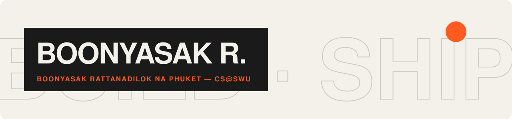

 

- 🎓 Computer Science student at **Srinakharinwirot University (SWU)**, Bangkok 🇹🇭
- 🚀 Love turning ideas into working prototypes — fast
- 🏆 Regular at hackathons: **SPARK HACK (PTT Group)**, **OIC Hackathon**, **Hackathon BKK**
- 🤖 Currently exploring **AI apps**, **data / ML**, and **cross-platform mobile**
- 🧵 Side quest: bringing Thai **mudmee (ผ้ามัดหมี่)** weaving into the digital world

  
   
  
   
  

| Project | What it is | Stack |
|---|---|---|
| 🔐 [**trustscan**](https://github.com/BoonyasakR/trustscan) | Digital power-of-attorney (e-POA) prototype with mock ThaiD login · [live demo](https://trustscan-alpha.vercel.app) |   |
| ⚡ [**Spark-hack-Prototype**](https://github.com/BoonyasakR/Spark-hack-Prototype) | Sustainability prototype for SPARK HACK S2 (PTT Group) |  |
| 🇹🇭 [**laithai**](https://github.com/BoonyasakR/laithai) | Thai pattern / culture web app |  |
| 📍 [**pinme-cp252**](https://github.com/BoonyasakR/pinme-cp252) | PinMe — CP252 course project |  |
| 🎬 [**project-recommentmovie-data**](https://github.com/BoonyasakR/project-recommentmovie-data) | Movie recommendation system |  |
| 📱 [**CP213_165_LearnAndroid**](https://github.com/BoonyasakR/CP213_165_LearnAndroid) | Mobile dev coursework |  |

  
  
   
  

  

*"What stands in the way becomes the way."* 
— Marcus Aurelius, <i>Meditations</i>

